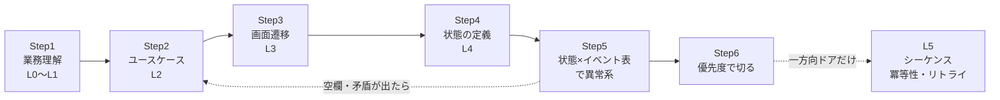

# 構造化（kouzouka）

要件定義から設計に進むときに、**「解像度を1段ずつ上げ、各段で"状態×イベント"の全マスを埋める」** ための学習ノート・テンプレート・動くサンプルです。

```
業務理解 → フロー → 粒度を決める → ハッピーパス → 異常系
```

## 練習問題アプリ「構造化ドリル帳」

**この型を、手を動かしながら約6〜7時間で身につけるブラウザアプリ**です。インストール不要で、スマホでも動きます。

- 公開ページ（GitHub Pages を有効にした後）：https://kento20020.github.io/kouzouka/
- 手元で開く：リポジトリ直下の [`index.html`](index.html) をブラウザで開くだけ

パン屋さん（ひだまりベーカリー）から予約アプリの相談を受けた新人として、L0 から L5 まで1段ずつ下りていきます。最後の**卒業制作**では、あなたが普段使っているアプリを1つ選び、構造化フロー（L0〜L5＋優先度）を1本書き上げて Markdown で保存します。

| 章 | 内容 | 主な練習 |
| --- | --- | --- |
| 0 はじまり | 構造化の定義・型の順番・ゴールを知る | 診断テスト（16問） |
| 1 ズームの階段 | L0〜L5 の粒度、粒度ミス、一方向／二方向ドア | 付箋の仕分け、間違い探し |
| 2 業務を聞く | As-Is → 困りごと → To-Be、スイムレーン図 | **店長へのヒアリング・シミュレーション**、実践ミッション |
| 3 ユースケース | 基本・代替・例外フロー、事後条件 | 並べ替え、ユースケースを書く |
| 4 画面遷移 | push／replace／reset、ログインと戻るの罠 | **画面スタックのシミュレーター**、実機で戻るを押すミッション |
| 5 状態の定義 | 状態とイベント、true/false の罠、3つの層、派生値 | ありえない状態探し |
| 6 状態×イベント表 | 全マスを埋める、8つの問い、穴探し | **25マスの表パズル**、機内モード実験ミッション |
| 7 通信と冪等性 | 切断は2種類、request_id のルール、再試行 | **二重予約を起こして防ぐ実験室** |
| 8 優先度 | Tier0〜2、影響×頻度×取り返し、既知の挙動 | 点数づけ |
| 9 卒業制作 | 既存アプリを L0〜L5 で構造化 | スイムレーン自動描画・空欄カウンター付きの編集画面、Markdown 書き出し |
| 10 修了テスト | 診断テストと同じ問題で伸びを比べる | 分野ごとの成長グラフ・修了証 |

飽きずに続けられるように、XP とレベル、連続正解、はなまる、章ごとのスタンプ、集めると卒業制作のカンペになる「型カード」、バッジを入れています。記録はブラウザに自動保存され、「記録」ページから書き出し・読み込みもできます。

claude.ai の Artifact として開いた場合は、さらに次が使えます。
- 書く問題と卒業制作で、**赤ペンAIコーチ**（Claude）の添削を受けられる
- 記録が Claude アカウントに保存され、別の端末でも続きから学べる

GitHub Pages では AI 添削の代わりに「添削の依頼文をコピー」ボタンが出るので、Claude のチャットに貼れば同じ観点で添削してもらえます。

### GitHub Pages で公開する

1. GitHub のリポジトリで **Settings → Pages** を開く
2. **Build and deployment** の Source で **Deploy from a branch** を選ぶ
3. Branch で公開したいブランチ（例：`main`、またはこのブランチ）と **/(root)** を選んで **Save**
4. 1〜2分後に `https://kento20020.github.io/kouzouka/` で開けます

リポジトリ直下の `.nojekyll` により、`index.html` はそのまま配信されます。

### アプリを直すとき

教材やプログラムは [`app/src/`](app/src) にあります。直したら `npm run app:build` で `index.html` を作り直してください（作り直し忘れはテストが見つけます）。詳しくは [app/README.md](app/README.md)。

---

この順番は王道です。ただし、このままだと次の4点が抜けます。

| # | 足りないこと | 一言で | 詳しく |
| --- | --- | --- | --- |
| ① | 粒度は1つに決めない | 1段ずつズームしていく | [02 粒度：ズームの階段](docs/02-zoom-levels.md) |
| ② | ハッピーパスと異常系の間に「状態の定義」を入れる | 状態がないと異常系は出せない | [03 手順 Step4](docs/03-six-steps.md#step4-状態の定義ここが抜けがち) |
| ③ | 異常系は思いつきで出さない | 表を使って漏れなく出す | [03 手順 Step5](docs/03-six-steps.md#step5-状態イベント表で異常系を出す)・[06 8つの問い](docs/06-eight-questions.md) |
| ④ | 全部はやらない | 優先度で切る | [07 どこまでやるか](docs/07-prioritization.md) |

## 全体の流れ



## 目次

| 章 | 内容 |
| --- | --- |
| [01 分野マップ](docs/01-skill-map.md) | この力を構成する「名前のある分野」と、それぞれ何を学べばいいか |
| [02 粒度：ズームの階段](docs/02-zoom-levels.md) | L0〜L5 の定義、粒度ミスの見分け方、どこまで下りるか（一方向／二方向ドア） |
| [03 手順の型（6ステップ）](docs/03-six-steps.md) | 各ステップの入力・作業・成果物・完了条件・よくある失敗 |
| [04 具体例：「AIに送る」](docs/04-example-send-to-ai.md) | 状態遷移図、全42マスの表、通信途中の失敗、冪等キー、型設計 |
| [05 戻るボタンとログイン](docs/05-navigation-and-auth.md) | push／replace／reset、Android・iOS・Web の違い、認証まわりの状態 |
| [06 異常系を出す「8つの問い」](docs/06-eight-questions.md) | 問いごとの確認項目、入力系・環境系、HAZOP との対応 |
| [07 どこまでやるか](docs/07-prioritization.md) | Tier0〜2、点数づけシート、「やらない」の書き方 |
| [08 鍛え方](docs/08-training.md) | 既存アプリの逆設計、端末での試し方、8週間プラン |
| [09 参考書・資料](docs/09-references.md) | 分野別の本と無料資料、読む順番 |
| [10 元の文章へのレビュー](docs/10-review-notes.md) | 元の解説で補足・修正したほうがよい点 |

## テンプレート（コピーして埋める）

| ファイル | 使う場面 |
| --- | --- |
| [ヒアリングシート](templates/hearing-sheet.md) | Step1：As-Is → 困りごと → To-Be を聞く |
| [ユースケース記述](templates/usecase.md) | Step2：基本／代替／例外フローと事後条件 |
| [画面遷移表](templates/screen-transition-table.md) | Step3：遷移元・イベント・遷移先・条件・push/replace/reset |
| [状態の定義](templates/state-definition.md) | Step4：アプリ全体／画面／操作の3層 |
| [状態×イベント表](templates/state-event-table.md) | Step5：全マスを埋めて空欄をなくす |
| [シーケンス図](templates/sequence.md) | L5：端末⇔サーバ⇔外部サービス、失敗の位置 |
| [優先度シート](templates/priority-sheet.md) | Step6：影響×頻度×取り返しのつかなさで点数をつける |
| [AIレビュー用プロンプト](templates/ai-review-prompt.md) | 表の空欄・矛盾・抜けをAIに指摘させる |

## 動くサンプル（`examples/send-to-ai`）

「状態遷移図とコードの型を1対1にする」と「空欄はバグ」を、実際に動くコードで確かめられます。

| ファイル | 内容 |
| --- | --- |
| [sendState.ts](examples/send-to-ai/sendState.ts) | 画面側の状態機械。6状態×7イベントの全42マスを定義。**1マスでも消すと型エラー** |
| [idempotency.ts](examples/send-to-ai/idempotency.ts) | サーバー側の冪等キー処理。同じ requestId は2回処理せず、1回目の結果を返す |
| [SPEC.md](examples/send-to-ai/SPEC.md) | コードから自動生成した状態遷移図と状態×イベント表 |
| `*.test.ts` | 全マスの状態遷移テスト、異常系テスト、仕様書とコードのズレ検出 |

```bash
npm install
npm run check   # 型チェック + アプリのビルド + テスト（サンプル60件・アプリ23件）
npm run spec    # sendState.ts から SPEC.md を作り直す
```

Node.js 22.18 以上が必要です（TypeScript をそのまま実行するため）。

試しに `sendState.ts` の `TRANSITIONS` から1マス消して `npm run typecheck` を実行すると、次のように怒られます。

```
error TS2741: Property 'RETRY' is missing in type '{ INPUT: ...; FAIL: ...; }'
but required in type '{ INPUT: Cell<"done", "INPUT">; ...; RETRY: Cell<...>; }'.
```

「完了状態で再試行されたらどうするか」が決まっていない、とコンパイラが教えてくれたことになります。

## おすすめの読む順番

1. 時間がない → この README → [04 具体例](docs/04-example-send-to-ai.md) → [06 8つの問い](docs/06-eight-questions.md)
2. 手を動かしたい → [08 鍛え方](docs/08-training.md) の1週目 → テンプレートを埋める
3. 体系的に学びたい → 01 から順番に → [09 参考書](docs/09-references.md)
