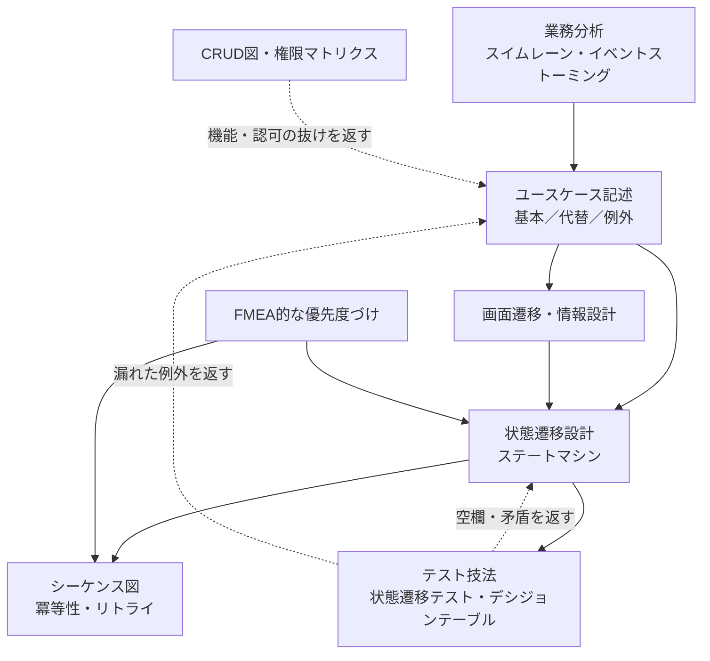

# 01 分野マップ：この力は「名前のある分野」の組み合わせ

「解像度を1段ずつ上げ、各段で状態×イベントの全マスを埋める力」は、1つの分野ではありません。
いくつかの名前のある分野の組み合わせです。**名前が分かれば、それぞれ個別に勉強できます**（本も資料も検索語も見つかる）。

## 基本の対応表

| やりたいこと | 分野・技法 | 何ができるようになるか | 検索語の例 |
| --- | --- | --- | --- |
| 業務を理解してフローにする | 業務分析・スイムレーン図（BPMN） | 「誰が・何を・どの順で」を1枚にする。手待ち・差し戻し・属人化が見える | スイムレーン 書き方、BPMN 入門、As-Is To-Be |
| ハッピールートと例外ルート | ユースケース記述（基本／代替／例外フロー） | 1つのゴールに対する筋道と、そこから外れる道を文章で書き分ける | ユースケース記述 例、Cockburn ユースケース |
| 画面と遷移 | 画面遷移図・情報設計（IA） | 画面の一覧、画面どうしのつながり、戻る・中断の挙動を決める | 画面遷移図 書き方、情報アーキテクチャ |
| 連打・切断時の挙動 | 状態遷移設計（ステートマシン・ステートチャート） | 「今どの状態か」と「何が起きたか」の組み合わせで挙動を決める | 状態遷移図、ステートチャート、XState |
| 通信途中の失敗 | シーケンス図・冪等性・リトライ設計 | 「どこで切れたか」で結果が違うことに気づき、二重実行を防ぐ | 冪等性 API、Idempotency-Key、指数バックオフ |
| 抜け漏れの検出 | テスト技法（状態遷移テスト・デシジョンテーブル） | 思いつきではなく「型」で漏れなく異常系を出す | 状態遷移テスト、デシジョンテーブル、境界値分析 |

**最後の行は見落としがちです。** 異常系を漏れなく出す「型」は、テスト技法の分野が一番体系化しています。
設計者がテスト技法を学ぶと、「テストで見つかるはずの穴」を設計の段階で先に埋められます。

## 追加で知っておくと効く分野

元の6分野に加えて、次の技法を知っていると「表で漏れなく」の道具が増えます。

| 分野・技法 | 何に効くか | ひとこと |
| --- | --- | --- |
| **CRUD図（CRUDマトリクス）** | 機能やデータの抜け漏れ | 行＝機能、列＝データ（エンティティ）、マス＝作成C／参照R／更新U／削除D。「誰も作らないデータ」「誰も消さないデータ」があれば機能が足りない |
| **権限マトリクス** | 「別の人なら？」の抜け漏れ | 行＝ロール（未ログイン・一般・管理者…）、列＝操作×対象（自分のデータ／他人のデータ）。空欄があれば認可の仕様が未定 |
| **デシジョンテーブル** | 条件の組み合わせの抜け漏れ | 「会員かつクーポンありかつ初回」のような条件の全組み合わせを表にする |
| **EARS（要求の書き方の型）** | 状態×イベントを文章の仕様にする | `While <状態>, when <イベント>, the system shall <応答>`。状態×イベント表の1マスがそのまま1文の要求になる |
| **イベントストーミング** | L1の業務理解 | 業務で起きる「出来事（〜された）」を付箋で時系列に並べ、関係者と一緒に業務を掘り起こす |
| **USDM／RDRA** | 日本でよく使われる要求・要件の整理法 | USDM は要求と仕様を階層で書く。RDRA は「システム価値→外部環境→境界→システム」の順にモデルで要件を整理する |
| **FMEA（故障モード影響解析）** | 優先度づけ | 「影響度×発生頻度×検出しにくさ」で点数をつける。[07章](07-prioritization.md)の判断軸と同じ発想 |
| **HAZOP（ガイドワード）** | 異常系の発想 | 「無い・多い・少ない・逆・早い・遅い・前・後」などの決まった言葉を各ステップに当てる。[06章](06-eight-questions.md)の8つの問いはこれと同じ発想 |
| **C4モデル** | 粒度（ズーム）の考え方 | Context→Container→Component→Code の4段で構成図をズームする。フローにも同じ発想を使う |
| **OWASP API Security Top 10** | 「他人のデータが見えない」を守る | 1位は BOLA（オブジェクト単位の認可の不備）。ID を書き換えると他人のデータが見える、という典型的な穴 |

## 分野どうしのつながり

設計（上から下へ）とテスト技法（下から上へ）が往復するのがポイントです。
テスト技法で見つかった空欄や矛盾は、設計に戻して直します。

## 学ぶ順番のおすすめ

1. **状態遷移設計 ＋ 状態遷移テスト**（一番効果が大きい。1機能から始められる）
2. **ユースケース記述**（例外フローと事後条件の書き方だけ先に覚える）
3. **画面遷移図**（push／replace／reset を意識する）
4. **シーケンス図 ＋ 冪等性**（通信を伴う機能、特に課金・決済・投稿・AI呼び出し）
5. **業務分析・スイムレーン図**（顧客の業務を扱うようになったら）
6. **デシジョンテーブル・CRUD図・権限マトリクス**（機能が増えてきたら）

それぞれの本と資料は [09 参考書・資料](09-references.md) にまとめています。
