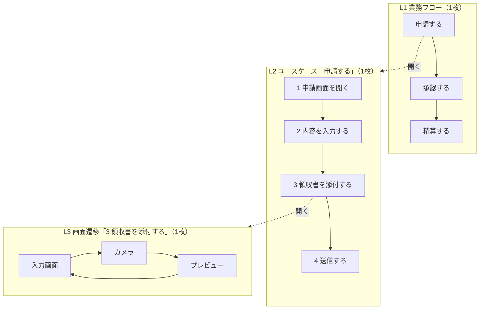

# 02 粒度（レベル感）の決め方：ズームの階段

**粒度は1つに決めません。1段ずつズームしていきます。**
「この図はどの粒度で描くべきか」で迷うのは、1枚の図に複数の粒度を入れようとしているからです。

## ズームの階段

```
L0 目的        なぜ作る・誰が嬉しい
 ↓
L1 業務フロー   人と仕事の流れ
 ↓
L2 ユースケース 1ゴール＝1本の筋
 ↓
L3 画面遷移     画面とボタン
 ↓
L4 状態遷移     1機能の中の状態
 ↓
L5 シーケンス   端末⇔サーバ⇔AI
```

## 各レベルの詳細

| レベル | 答える問い | 成果物（図・文書） | 主語になるもの | 誰と話すか | 完了条件 |
| --- | --- | --- | --- | --- | --- |
| L0 目的 | なぜ作るのか。誰が何に困っていて、何が良くなれば成功か | 1枚の目的文、成功指標（KPI）、やらないことリスト | 会社・部署・顧客 | 経営者・責任者 | 「何がどうなれば成功か」を数字か具体例で言える |
| L1 業務フロー | 人と仕事はどう流れているか | スイムレーン図、業務一覧 | 人・部署・役割 | 現場の担当者 | システム化する範囲（どの箱をシステムがやるか）に線が引ける |
| L2 ユースケース | 1つのゴールを達成する筋道は何か。どこで外れるか | ユースケース記述、ユースケース一覧 | アクター（利用者）とシステム | 現場担当者・企画 | 基本・代替・例外フローと事後条件がそろう |
| L3 画面遷移 | どの画面があり、どのボタンでどこへ行くか | 画面一覧、画面遷移図、遷移表 | 画面・ボタン | デザイナー・開発者 | 全遷移に push／replace／reset と条件が書いてある |
| L4 状態遷移 | 1機能の中で、どんな状態があり、何が起きたらどうなるか | 状態遷移図、状態×イベント表 | 状態・イベント | 開発者・テスト担当 | 状態×イベント表に空欄がない |
| L5 シーケンス | 端末・サーバ・外部サービスの間で、何がどの順に流れ、どこで失敗しうるか | シーケンス図、API仕様、エラーコード一覧 | 端末・サーバ・外部サービス | 開発者 | 失敗する位置ごとに、再試行してよいかが決まっている |

## 粒度ミスの見分け方

その図に「これ」が出てきたら、粒度が混ざっています。

| レベル | これが出てきたら粒度ミス | なぜダメか | 正しい置き場所 |
| --- | --- | --- | --- |
| L1 業務フロー | ボタン名・画面名 | 業務の人には不要な情報で、議論が画面デザインにそれる | L3 |
| L2 ユースケース | 画面のレイアウト・色・API名 | ユースケースは「何をするか」で「どう見せるか」ではない | L3・L5 |
| L3 画面遷移 | API・DB・リトライ回数 | 画面の流れが読めなくなる | L5 |
| L4 状態遷移 | 業務の目的・売上 | 1機能の挙動の議論に、経営の話が混ざる | L0 |
| L5 シーケンス | 画面デザイン | 通信の順番と失敗の議論がぼやける | L3 |

## ルール

### 1枚に1レベルだけ

混ぜると読めなくなります。C4モデル（Context→Container→Component→Code）と同じ発想で、**フローにもズームレベルがあります**。
地図アプリで「日本地図に番地まで書かない」のと同じです。拡大したいときは、別の縮尺の地図を開きます。

### 上の図の箱1個 ＝ 下の図1枚

L1の「申請する」という箱を開くとL2のユースケースになり、L2の1ステップを開くとL3の数画面になります。



箱と下の図に同じ名前（ID）をつけておくと、上下を行き来しやすくなります（例：L1-03「申請する」→ UC-03「申請する」）。

### 1枚の箱は5〜9個まで

15個あれば分割し、3個なら統合します。
これは「人が一度に扱える塊は7±2個」（ミラー、1956年）に由来する経験則です。
なお、その後の研究（コーワン、2001年）では「実際は4個前後」とも言われています。
**厳密な数字ではなく「多すぎたら分ける、少なすぎたらまとめる」の目安**として使ってください。

### 「場合による」が3回出たら、1段下りる合図

レビューで「それは場合によります」が何度も出るなら、その箱の中に別の図が隠れています。
その「場合」を状態や分岐として、1段下のレベルの図に描きます。

### どこまで下りるか：その図だけでテストケースが書けたら、それ以上細かくしない

- テスト担当者がその図だけを見て「この操作をしたら、こうなるはず」と書けるか
- 書けないなら、まだ情報が足りない（もう1段下りる）
- 書けるなら、それ以上細かくしても読む人が減るだけ

## どこまで下りるかは「一方向ドア／二方向ドア」で決める

Amazon のジェフ・ベゾスが株主への手紙（2015年）で使った考え方です。
**後で引き返せる決定（二方向ドア）は軽く速く、引き返せない決定（一方向ドア）は慎重に**決めます。

| 種類 | 特徴 | 例 | どこまで下りるか |
| --- | --- | --- | --- |
| 二方向ドア（後で変えられる） | 間違えてもリリース後に直せる。影響が画面の中で閉じている | 戻るボタンの挙動、文言、画面の並び、ボタンの色、並び順の初期値 | L3で軽く決めて、後で直す |
| 一方向ドア（後で変えにくい） | データ・お金・他システム・利用者の信頼に影響し、後から直すと移行や補償が必要 | 認証の仕組み、状態をどこに持つか（端末／サーバ）、二重送信の扱い（AI課金・決済・投稿）、IDの採番方法、データの削除方法（論理／物理）、外部に公開するAPIの形 | 先にL4〜L5まで下りて厳密に決める |

### 見分けるための3つの質問

1. **間違えたら、データを直す必要があるか？**（あれば一方向）
2. **間違えたら、お金や信頼の補償が必要か？**（あれば一方向）
3. **間違えたら、自分たち以外（他システム・古いアプリ・外部の利用者）の変更が必要か？**（あれば一方向）

特にモバイルアプリは、古いバージョンを使い続ける人がいるため、**サーバーとアプリの間の約束（APIの形・エラーの返し方）は一方向ドアになりやすい**ことに注意してください。

### 一方向ドアの決定は記録を残す

一方向ドアの決定は、ADR（Architecture Decision Record：設計判断の記録）として「何を・なぜ・他に何を検討したか」を短く残しておくと、後から「なぜこうなっているのか」で迷いません。

```markdown
# ADR-001 AI送信の二重実行は冪等キーで防ぐ
- 状況：通信が返る途中で切れると、端末は失敗と思って再送し、AIが2回動く（課金2回・履歴2件）
- 決定：端末が送信ごとに request_id を発行し、サーバーは (user_id, request_id) で1回だけ処理する
- 検討した他の案：画面のボタン無効化だけ（自動再送・複数タブを防げないので却下）
- 影響：API に request_id が必須になる。古いアプリ向けに移行期間を設ける
```
