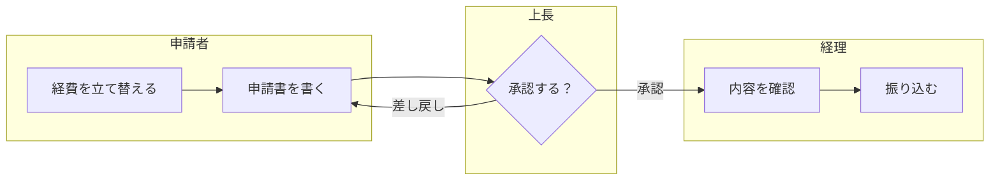

# 03 手順の型（6ステップ）

| Step | やること | レベル | 成果物 | テンプレート |
| --- | --- | --- | --- | --- |
| 1 | 業務理解 | L0〜L1 | 目的文、スイムレーン図、困りごと一覧 | [ヒアリングシート](../templates/hearing-sheet.md) |
| 2 | ユースケース | L2 | ユースケース一覧、ユースケース記述 | [ユースケース記述](../templates/usecase.md) |
| 3 | 画面遷移 | L3 | 画面一覧、画面遷移図、遷移表 | [画面遷移表](../templates/screen-transition-table.md) |
| 4 | 状態の定義 | L4 | 3層の状態一覧 | [状態の定義](../templates/state-definition.md) |
| 5 | 状態×イベント表で異常系を出す | L4（必要ならL5） | 状態×イベント表、シーケンス図 | [状態×イベント表](../templates/state-event-table.md)・[シーケンス図](../templates/sequence.md) |
| 6 | 優先度で切る | ― | Tier分け、「やらない」リスト | [優先度シート](../templates/priority-sheet.md) |

Step は一方通行ではありません。**Step5 で空欄や矛盾が見つかったら、Step2 に戻ってユースケースを直す**のが普通です。

---

## Step1 業務理解（L0〜L1）

**目的**：何のために作るのかを決め、今の仕事の流れと困りごとを1枚にする。

「今どうしているか（As-Is）→ 困りごと → あるべき姿（To-Be）」の順に進めます。
いきなり To-Be（こうしたい）から聞くと、今の業務にある例外が見えないまま設計が始まってしまいます。

### ヒアリングで効く質問

**流れと手間**
- 一番時間を食っている作業は何か。週に・月に何時間か
- 今は Excel・紙・電話・メール・チャットで何をしているか
- 同じ情報を何回書き写しているか（転記はミスと手間の温床）

**例外**
- どんな例外が起きるか。月末・繁忙期・担当者不在のときはどうなるか
- 「普通はこうだけど、たまにこうなる」ことは何か
- 差し戻し・やり直し・取り消しは、どのくらいの頻度で起きるか

**人と責任**
- 誰が承認するか。承認者が不在なら誰が代わりにやるか
- 止まったら誰が困るか。どのくらい止まると困るか（1時間？1日？）
- その作業ができるのは誰か（1人しかいないなら属人化）

**量と時間**
- 1日・1か月に何件あるか。一番多い日は何件か（ピーク）
- 何年分のデータを残す必要があるか

**実物**
- 実物の帳票・Excel・画面を見せてもらう（話より実物の方が例外が見えます）
- Excel の「備考」列、手書きのメモ、付箋は例外の宝庫です

### スイムレーン図の描き方



- 横のレーン＝人・部署・システム。縦に並べてもよい
- 箱は「動詞＋目的語」（〜を確認する）。名詞だけの箱にしない
- 分岐（ひし形）には、必ず全部の出口に名前をつける（「承認」「差し戻し」「保留」…）
- 「待ち」が発生する場所に印をつける（例：上長が出張中だと3日止まる）

### 成果物と完了条件

- 目的文（誰の・何を・どう良くする）と、成功を測る指標
- As-Is のスイムレーン図と、困りごと一覧（頻度・影響つき）
- システム化する範囲の線（どの箱をシステムがやり、どの箱は人に残すか）
- **完了条件**：現場の人に図を見せて「そう、こうやってる。あと月末だけはこうなる」と言われ、それも図に入っている

### よくある失敗

- 責任者の話だけで描き、現場の実際の流れ（裏ワザ・抜け道）が抜ける
- 例外を「レアケースなので」と捨てる（後で必ず来ます。捨てるなら Step6 で明示的に捨てる）

---

## Step2 ユースケース（L2）

**目的**：1つのゴールごとに「普通に進む筋」と「外れる筋」を書き分ける。
これがそのまま「ハッピーパス＋異常系」の骨組みになります。

```
名前:     AIに質問を送る
ID:       UC-05
アクター: ログイン済みユーザー
事前条件: ログイン済み・入力あり
トリガー: ユーザーが送信ボタンを押す
基本フロー:
  1. ユーザーが質問を入力する
  2. ユーザーが送信する
  3. システムが回答を表示する
代替フロー:
  2a. 画像を添付して送信する
      → 基本フロー3へ
例外フロー:
  2b. 通信に失敗した
      1. システムは入力内容を残したままエラーを表示する
      2. ユーザーが再試行する → 基本フロー2へ（同じ依頼として送る）
  2c. セッションが切れていた
      1. システムは入力内容を残したまま再ログインを求める
      2. 再ログイン後、自動で再送する → 基本フロー3へ
  3a. AIの回答が途中で途切れた
      1. システムは途中までの回答を残し、続きを再試行できるようにする
事後条件:
  成功時: 履歴に1件保存されている（2件ではない）。利用回数が1回分増えている
  失敗時: 履歴は増えていない。利用回数も増えていない。入力内容は残っている
```

**事後条件を書くと、二重保存のような異常系に自然と気づけます。**
「1件保存（2件ではない）」と書いた瞬間に、「どうすれば2件になってしまうか？」を考えることになるからです。
失敗時の事後条件（何が起きていてはいけないか）も書くと、さらに強くなります。

### 書き方のコツ

- 1ステップ＝1動作。主語を書く（「ユーザーが〜する」「システムが〜する」）
- UI の詳細（ボタンの色、画面の配置）は書かない。それは L3 の仕事
- 代替フロー（別のやり方でも成功する）と例外フロー（失敗・中断する）を分ける
- 例外フローの番号は「どのステップで起きるか」を示す（2b＝ステップ2で起きる例外）
- 例外フローの最後には、必ず「どこへ戻るか／どこで終わるか」を書く

### 成果物と完了条件

- ユースケース一覧（ID・名前・アクター・優先度）
- 主要なユースケースの記述
- **完了条件**：基本フローの各ステップに「ここで失敗したら？」を当て、例外フローか「起きない理由」のどちらかが書いてある

---

## Step3 画面遷移（L3）

**目的**：画面の一覧と、画面どうしのつながりを決める。

画面一覧と遷移表（遷移元・イベント・遷移先・条件）を作ります。

| No | 遷移元 | イベント | 条件 | 遷移先 | 方式 | 備考 |
| --- | --- | --- | --- | --- | --- | --- |
| T01 | 起動 | ― | 未ログイン | ログイン | reset | |
| T02 | 起動 | ― | ログイン済み | ホーム | reset | |
| T03 | ログイン | ログイン成功 | 初回 | 使い方案内 | reset | 戻るでログインに戻れない |
| T04 | ログイン | ログイン成功 | 2回目以降 | ホーム（または returnTo） | reset | |
| T05 | ホーム | チャットをタップ | ― | チャット | push | |
| T06 | チャット | 回答をタップ | ― | 詳細 | push | 二重タップで2枚積まない |
| T07 | 申込入力 | 送信成功 | ― | 申込完了 | replace | 戻るで入力に戻って再送できないように |

戻るボタン対策として、各遷移が次のどれかまで決めます（詳しくは [05章](05-navigation-and-auth.md)）。

| 方式 | 意味 | 戻るボタンを押すと | 使う場面 |
| --- | --- | --- | --- |
| push | 今の画面の上に積む | 元の画面に戻る | 一覧→詳細など、普通の前進 |
| replace | 今の画面を置き換える | 置き換える前の、さらに1つ前の画面に戻る | 完了画面、手順の途中で戻らせたくない画面 |
| reset | 全部捨てて置き直す | （戻る先がない）アプリを閉じる・裏へ回す | ログイン成功、ログアウト、初回案内の終了 |

### 成果物と完了条件

- 画面一覧（ID・名前・ログイン必須か・どこから来られるか）
- 画面遷移図と遷移表
- **完了条件**：全ての遷移に方式（push／replace／reset）と条件が書いてあり、「通知・リンクから直接来た場合」の入口も書いてある

---

## Step4 状態の定義（ここが抜けがち）

**目的**：異常系を出す前に、「何が起きたか（イベント）」を当てる相手である「状態」を全部並べる。

ハッピーパスを書いたあと、いきなり異常系を考えると思いつきになります。
**状態が並んでいないと、「どの状態で、何が起きたら」の組み合わせが作れない**からです。

状態を3層に分けます。

| 層 | 状態の例 | 持つ場所の例 |
| --- | --- | --- |
| アプリ全体 | 認証（未ログイン／ログイン済み／セッション切れ／権限なし）、通信（オンライン／オフライン）、アプリ（前面／裏） | アプリ全体のストア |
| 画面 | 初期・読み込み中・0件・表示中・エラー（＋再読み込み中・続きを読み込み中） | 画面ごと |
| 操作 | 待機・送信中・成功・失敗（＋受信中・キャンセル済み） | ボタン・フォームごと |

### 3層は「掛け算」になる

層は独立しているので、本当の状態は掛け算になります（例：「画面は表示中」かつ「操作は送信中」かつ「通信はオフライン」）。
全部の組み合わせを1枚の表にすると爆発するので、次のように分けます。

1. 各層ごとに、状態×イベント表を作る（画面の表、操作の表）
2. 上の層のイベント（オフラインになった・セッションが切れた・裏へ回った）は、下の層の表の**列（イベント）として**入れる

つまり「アプリ全体の状態の変化」は、各画面・各操作から見ると「イベント」です。
こうすると、表を分けたまま、層をまたぐ異常系（送信中にセッションが切れた、など）も漏れません。

### 状態と「派生値」を分ける

- 状態：それ自体を覚えておく必要があるもの（送信中か、どの requestId か）
- 派生値：状態から計算できるもの（送信ボタンを押せるか＝状態が「送信可能」か「エラー」）

派生値まで状態として持つと、「状態は送信中なのにボタンは押せる」のような食い違いが起きます。
派生値は関数で毎回計算します（[サンプルの `canSubmit()`](../examples/send-to-ai/sendState.ts)）。

### 成果物と完了条件

- 3層それぞれの状態一覧（状態名・意味・入る条件・出る条件）
- **完了条件**：画面のデザイン案の全パターン（読み込み中・0件・エラー…）が、どれかの状態に対応している

---

## Step5 状態×イベント表で異常系を出す

**目的**：思いつきに頼らず、異常系を漏れなく出す。

行に状態、列にイベントを並べ、**全マスに「どうなるか」を書きます**。

| 状態＼イベント | タップ | 連打 | 戻る | 切断 | セッション切れ | アプリが裏へ |
| --- | --- | --- | --- | --- | --- | --- |
| 待機 | 送信中へ | （1回目だけ有効） | 前の画面へ | オフライン表示 | 再ログイン | 何もしない |
| 送信中 | ― | 無視 | 中断を確認 | エラー、入力保持 | 入力保持で再ログイン→再送 | 復帰時に結果を問い合わせ |
| 成功 | … | … | … | … | … | … |
| 失敗 | … | … | … | … | … | … |

**空欄は「仕様が決まっていない＝バグ」です。** 思いつきに頼らず、穴が自動的に見つかるのがこの方法の強みです。

### 埋め方の手順

1. 行（状態）は Step4 から持ってくる
2. 列（イベント）は「ユーザー操作」「通信」「アプリ全体の変化」「時間」の4種類から集める
   - ユーザー操作：タップ・連打・戻る・入力・キャンセル・画面回転
   - 通信：応答あり・失敗・タイムアウト・切断・遅延
   - アプリ全体：セッション切れ・オフライン・裏へ／復帰・プッシュ通知・強制終了
   - 時間：一定時間経過・日付の変わり目・有効期限
3. まず全マスを「無視」「遷移（行き先）」「要検討」の3つで仮に埋める
4. 「要検討」のマスを1つずつ決める。決められないマスは、ユースケースに戻って関係者に確認する
5. **「無視」も仕様として書く**。「無視」と「決めていない」は違います

### 表を文章の仕様にする（EARS）

1マス＝1文で書けます。

- `送信中の状態で、送信ボタンが押されたとき、システムは何もしない。`（While 送信中, when 送信タップ, …）
- `送信中の状態で、通信が切断されたとき、システムは入力内容を保持したままエラーを表示する。`

### 表をテストケースにする（状態遷移テスト）

| カバレッジ | 意味 | この表なら |
| --- | --- | --- |
| 全状態網羅 | 全ての状態を1回は通る | 6状態を通るシナリオ |
| 0スイッチ（全遷移網羅） | 有効な遷移を全部1回ずつ試す | 「遷移する」マスを全部 |
| 全マス網羅（無効遷移を含む） | 「無視」のマスも含めて全部試す | 6×7＝42マス全部 |
| 1スイッチ | 連続する2つの遷移の組み合わせを全部試す | 「失敗→再試行」「受信中→切断→再試行」など |

[サンプルのテスト](../examples/send-to-ai/sendState.test.ts)は全マス網羅（42マス）をループで自動生成しています。

### 成果物と完了条件

- 主要な機能の状態×イベント表（空欄なし）
- 一方向ドアに関わるマス（課金・決済・投稿・データ削除）のシーケンス図
- **完了条件**：空欄がゼロ。「要検討」がゼロ（または Step6 で Tier2 として明示的に記録）

---

## Step6 優先度で切る

**目的**：全部やると終わらないので、どこまでやるかを決めて書いておく。

| Tier | 方針 | 例 |
| --- | --- | --- |
| Tier0（必ずやる） | 起きたら取り返しがつかない | データが消えない／二重実行・二重課金にならない／他人のデータが見えない |
| Tier1（簡単にやる） | よく起きるが、汎用の仕組みで済む | エラー表示と再試行、オフライン表示、読み込み中の表示 |
| Tier2（記録だけ） | まれで、影響も小さい | 複数タブ間の同期、画面回転時の状態保持。「既知の挙動」として仕様書に書く |

判断軸は **影響の大きさ × 起きる頻度 × 取り返しのつかなさ** です。
**「やらない」と決めて書いておくのも立派な設計です。** 「決めていない」との違いはここにあります。

詳しい点数のつけ方は [07章](07-prioritization.md) を見てください。
