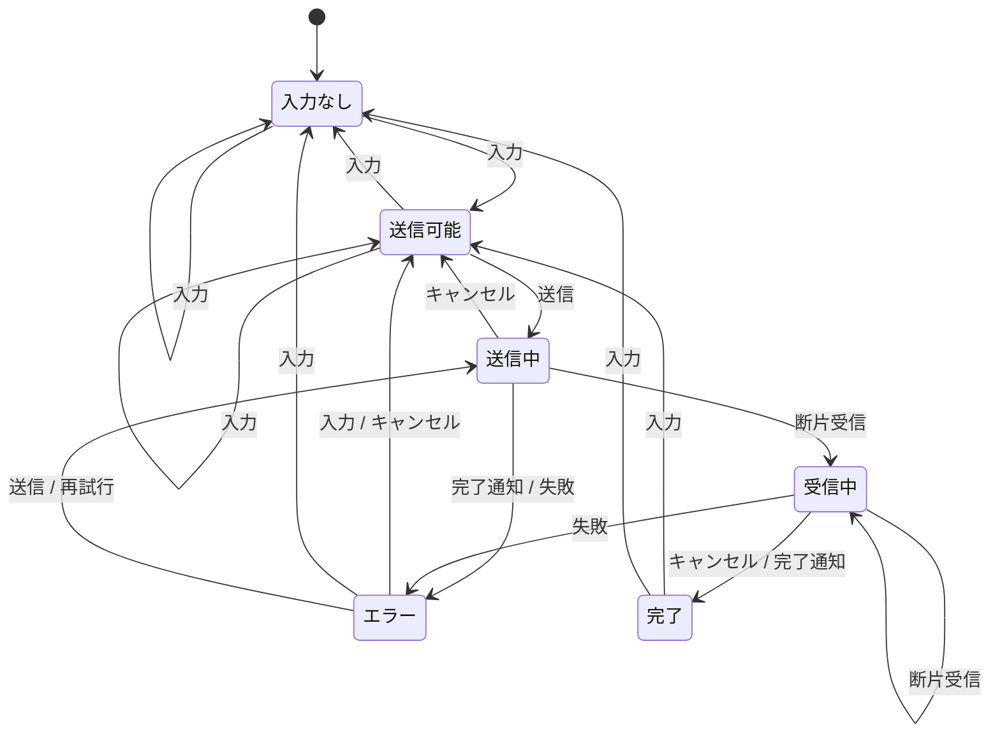
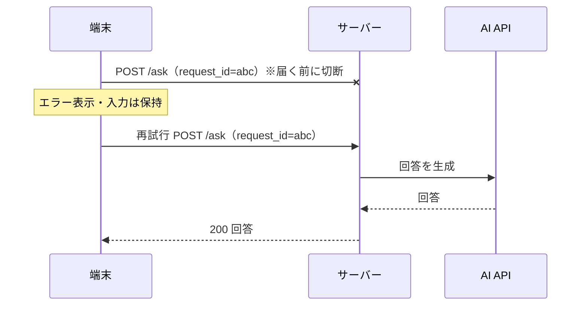
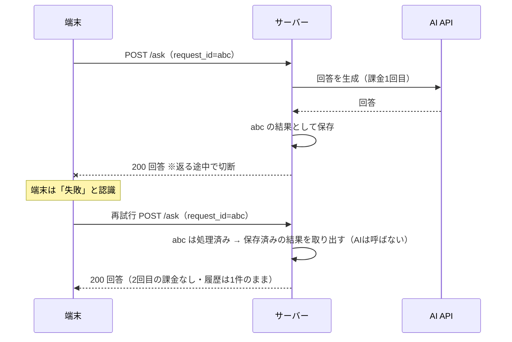

# 04 具体例：「AIに送る」を構造化する

チャット型のAIアプリで「質問を送って回答を受け取る」1機能を、L2〜L5まで下ろしてみます。
この章の内容は [examples/send-to-ai](../examples/send-to-ai) に動くコードとして置いてあります。

## 1. 状態遷移図

元の図（テキスト版）：

```
[入力なし]
  │ 入力
  ▼
[送信可能]◀───キャンセル───┐
  │ 送信                   │
  ▼                        │
[送信中]───────────────────┘
  │ 連打=無視
  ├─失敗─▶[エラー]─再試行─▶[送信中]
  │ 応答開始  (入力は保持)
  ▼
[受信中]─切断─▶[エラー]
  │ 完了
  ▼
[完了]
```

コードから自動生成した図（[SPEC.md](../examples/send-to-ai/SPEC.md) と同じもの）：



元の図と比べて増えた矢印があります。これらは**状態×イベント表を全マス埋めたことで見つかったもの**です。

| 増えた矢印 | 見つかった理由 |
| --- | --- |
| 受信中 →（キャンセル）→ 完了 | 「受信中＋キャンセル」のマスを埋めようとして、「生成を止める」機能の仕様が必要だと分かった |
| 送信中 →（完了通知）→ エラー | 「送信中＋応答完了」＝1文字も来ないまま完了した。AIのおかしな出力として扱うと決めた |
| エラー →（入力）→ 送信可能 | 「エラー＋入力」のマス。入力を書き換えたら別の依頼になる（requestId を作り直す）と決めた |
| エラー →（送信）→ 送信中 | 「エラー＋送信タップ」のマス。再試行と同じ扱いにする（requestId は同じ）と決めた |
| 完了 →（入力）→ 送信可能 | 「完了＋入力」のマス。次の質問を始める |

## 2. 状態×イベント表

元の表（抜粋）に、全マスを埋めて見つかった行を加えたものです。
全42マスは [SPEC.md](../examples/send-to-ai/SPEC.md) を見てください。

| 状態＋イベント | どうする | 出どころ |
| --- | --- | --- |
| 入力なし＋送信 | ボタンを押せないようにする | 元の表 |
| 送信中＋連打 | 無視する（ボタン無効化） | 元の表 |
| 送信中＋戻る | 中断を確認する。または裏で処理を続け、戻ったら結果を表示 | 元の表 |
| 送信中＋切断 | エラー表示。入力は残し、再試行できるようにする | 元の表 |
| 受信中＋切断 | 途中までの回答を残し、続きを再試行 | 元の表 |
| 送信中＋セッション切れ | 入力を残したまま再ログイン→自動で再送 | 元の表 |
| 送信中＋アプリが裏へ | 復帰時にサーバーへ結果を問い合わせる | 元の表 |
| 受信中＋キャンセル（停止） | ここまでの回答を残して完了扱いにする | 全マスで発見 |
| 送信中＋0文字で完了 | エラー（AIのおかしな出力）にして再試行できるようにする | 全マスで発見 |
| エラー＋入力を編集 | 別の依頼として扱い、次の送信で新しい requestId を発行する | 全マスで発見 |
| エラー＋送信ボタン | 再試行と同じ。requestId は使い回す | 全マスで発見 |
| エラー＋遅れて届いた応答 | 破棄する（再試行すればサーバーの保存済み結果が返るので損はない） | 全マスで発見 |
| 完了＋完了通知がもう1回 | 無視する（履歴を2件にしない） | 全マスで発見 |
| 送信中＋回数制限（429） | 「上限に達しました」と、再試行できる時刻を表示（`Retry-After` ヘッダを使う） | 8つの問い⑦ |

### 「送信中＋戻る」の2つの案は、一方向ドア

元の表には「中断を確認する」と「裏で処理を続け、戻ったら結果を表示」の2案があります。どちらを選ぶかで設計が大きく変わります。

| 案 | 状態をどこに持つか | 必要なもの |
| --- | --- | --- |
| 中断を確認する | 画面の中だけでよい | 確認ダイアログ。中断したらサーバーにも取り消しを伝えるか決める |
| 裏で続行する | 画面の外（アプリ全体のストア、またはサーバー）に持つ必要がある | 画面を離れても通信を続ける仕組み、戻ったときに結果を取り出す仕組み、別の画面にいるときの通知 |

「状態をどこに持つか」は [02章](02-zoom-levels.md) の一方向ドアです。ここは先に決めてから作ります。

## 3. ハッピーパスだけでは気づけない罠：「送信中に切断」は2種類ある

| | 切れた位置 | サーバーの状態 | 端末の認識 | 再送すると |
| --- | --- | --- | --- | --- |
| ケースA | リクエストがサーバーに届く前 | 何も起きていない | 失敗 | 問題なし |
| ケースB | サーバーで処理が終わり、レスポンスが返る途中 | **成功している**（AIは動き、課金も履歴保存も済み） | 失敗 | **AIが2回動き、課金も2回、履歴も2件** |

端末から見ると、AとBは区別できません。どちらも「応答が来なかった」だけです。

### ケースA：届く前に切れた



### ケースB：返る途中で切れた（ここが罠）



## 4. 対策は画面側とサーバー側の二重防御

| 守る場所 | やること | 防げるもの | 防げないもの |
| --- | --- | --- | --- |
| 画面側 | 送信中はボタンを無効にする。状態機械でも連打を無視する | 人間の連打 | 通信ライブラリの自動再送、複数タブ・複数端末、ケースBの再試行、悪意あるリクエスト |
| サーバー側 | 同じ request_id を2回処理しない（冪等キー）。2回目は1回目の結果を返す | 上の全部 | ― |

**画面側だけで守るのは不十分です。**
例えば Android でよく使われる通信ライブラリ OkHttp は、既定の設定で接続失敗時に自動で再試行することがあります（`retryOnConnectionFailure`）。アプリのコードに再送処理を書いていなくても、再送は起こりえます。

### request_id のルール（ここを間違えると冪等キーが効かない）

| 場面 | request_id | 理由 |
| --- | --- | --- |
| 送信ボタンを押した | **新しく発行**（UUID など） | ユーザーの「1回の依頼」に1つ |
| 自動再試行（通信ライブラリ・アプリ） | **同じものを使う** | 同じ依頼の再送だから |
| ユーザーが「再試行」を押した | **同じものを使う** | 同じ依頼の再送だから。ケースBならサーバーが保存済みの結果を返す |
| エラー中にもう一度「送信」を押した | **同じものを使う** | 内容が同じなら同じ依頼 |
| 入力を書き換えてから送信した | **新しく発行** | 別の依頼だから |
| 「回答を作り直す」ボタン | **新しく発行** | ユーザーが意図して2回目を頼んでいる（課金も2回でよい） |

元の文章の「送信ごとに端末で request_id を作り」は、**「HTTPリクエストを送るたび」ではなく「ユーザーが1回依頼するたび」**と読んでください。再試行のたびに新しいIDを作ると、冪等キーの意味がなくなります。

### サーバー側の振る舞い

| 届いたもの | サーバーの返事 | 補足 |
| --- | --- | --- |
| 初めての request_id | 処理して 200 | 処理を始める前に「処理中」として記録する |
| 処理済みの request_id（同じ内容） | **保存済みの結果**を 200 で返す | 拒否するだけでは、ケースBの端末は回答を受け取れない |
| 処理中の request_id | 409（処理中）、または処理が終わるまで待って結果を返す | 端末は少し待ってから再試行する |
| 同じ request_id で違う内容 | 422 などのエラー | 端末側のIDの使い回しバグを早く見つけられる |
| 期限切れの request_id | 新しい依頼として扱う | Stripe は少なくとも24時間保持してから消す |

ポイント：

- **キーはユーザーごとに分ける**（`user_id` と `request_id` の組で一意）。他人と同じ ID でも結果が混ざらず、他人の結果を覗き見されることもない
- **「処理中」の記録は原子的に**行う。DB のユニーク制約付き INSERT（`INSERT ... ON CONFLICT DO NOTHING` など）で、挿入できた1件だけが AI を呼ぶ
- **サーバーが処理中に落ちた**場合に備えて、「処理中」には期限（リース）をつける。期限を過ぎた「処理中」は放棄されたとみなして引き継ぐ
- AI の失敗で何も起きていないなら、キーを解放して再試行を受け付ける。課金が発生した後に失敗しうるなら、「失敗した」という結果を保存して同じ結果を返す
- HTTP の世界では `Idempotency-Key` ヘッダで送る方式が IETF で標準化が進められており、Stripe などが採用しています

```sql
-- 冪等キーの表（例）
CREATE TABLE idempotency_keys (
  user_id      BIGINT       NOT NULL,
  request_id   UUID         NOT NULL,
  fingerprint  TEXT         NOT NULL,          -- リクエスト本文のハッシュ
  state        TEXT         NOT NULL,          -- 'processing' | 'done' | 'failed'
  response     JSONB,                          -- 2回目以降に返す結果
  locked_until TIMESTAMPTZ,                    -- 処理中のリース期限
  created_at   TIMESTAMPTZ  NOT NULL DEFAULT now(),
  PRIMARY KEY (user_id, request_id)
);
```

動くスケッチは [idempotency.ts](../examples/send-to-ai/idempotency.ts) とそのテストにあります（AIが1回しか呼ばれないこと、同時に2件来たら片方が409になること、などを確認しています）。

## 5. リトライの設計

| 失敗の種類 | 自動で再試行するか | 方法 |
| --- | --- | --- |
| 接続できない・切断 | する（回数上限つき） | 指数バックオフ＋ジッター（1秒→2秒→4秒…に、ランダムなずれを足す） |
| タイムアウト | する（回数上限つき） | 同上。request_id は同じ |
| 429（回数制限）・503 | する | `Retry-After` ヘッダの秒数だけ待つ。なければ指数バックオフ |
| 401（認証切れ） | トークン更新の後に1回だけ | 更新に失敗したら再ログイン画面へ（入力は保持） |
| 400・422（リクエストが悪い） | しない | 同じものを送っても同じ結果になるので、エラーを表示する |
| 500 | 場合による | 冪等キーがあるなら再試行してよい。ないなら再試行しない |

- **ジッター**（ランダムなずれ）を入れるのは、障害から復旧した瞬間に全端末が同時に再試行してサーバーを再び落とすのを防ぐためです
- 自動再試行は回数（例：3回）と合計時間（例：30秒）の両方に上限をつけ、超えたらユーザーに「再試行」ボタンを見せます

### ストリーミング（少しずつ回答が届く）ときのタイムアウト

全体の時間で切ると、長い回答が途中で切られてしまいます。2種類に分けます。

| タイムアウト | 意味 | 目安の考え方 |
| --- | --- | --- |
| 最初の断片まで | 送信してから最初の1文字が届くまで | AIが考え始めるまでの時間。長めにとる |
| 断片の間隔（アイドル） | 前の断片から次の断片までの空き | 通信が詰まった・切れたことを早く検出する |

## 6. アプリが裏へ回ったとき

| OS | 何が起きるか |
| --- | --- |
| iOS | 裏へ回るとすぐにアプリが一時停止され、通信も切れうる。`beginBackgroundTask` で少しだけ延長できるが、長くは続けられない |
| Android | しばらくするとプロセスごと終了されることがある（プロセスの死）。戻ってきたとき、画面は復元されるがメモリ上の状態は消えている |

どちらにしても、**「裏へ回ったら通信は切れるもの」として設計します**。

1. サーバーは端末との接続が切れても、AI の生成を最後まで続けて結果を request_id で保存する
2. 端末は送信中の request_id を端末の保存領域に残しておく
3. 復帰したら `GET /requests/{request_id}` で結果を問い合わせる
   - 完了していれば結果を表示する
   - 処理中なら待つ（または続きを受け取る）
   - 見つからなければ（届いていなかった＝ケースA）同じ request_id で再送する

「受信中＋切断 → 続きを再試行」も同じ仕組みで実現できます。サーバーが結果を保存していれば、「最初から作り直す（課金がもう1回）」ではなく「保存済みの続きを受け取る」ことができます。
SSE（Server-Sent Events）を使うなら、`Last-Event-ID` で「どこまで受け取ったか」を伝えて続きから再開する方法もあります。

## 7. コードの構造化：状態を true/false の組み合わせで持たない

```ts
// ✕ isLoading と isError が同時に true になりうる
const [isLoading, setIsLoading] = useState(false);
const [isError, setIsError] = useState(false);
const [answer, setAnswer] = useState<string | null>(null);
// → 2×2×2＝8通りの組み合わせのうち、意味があるのは数通りだけ。残りは「ありえない状態」
```

```ts
// ○ ありえない状態を型で作れなくする（元の文章の型）
type SendState =
  | { kind: "idle" }
  | { kind: "sending"; requestId: string }
  | { kind: "streaming"; requestId: string; text: string }
  | { kind: "error"; reason: "offline" | "timeout" | "auth"; draft: string }
  | { kind: "done"; answer: string };
```

### 元の型をさらに良くするなら

元の型には、状態遷移図と照らし合わせると見つかる小さな穴があります。

| 気づいたこと | 直し方 |
| --- | --- |
| `sending` に `draft`（入力内容）がない。送信中に失敗したとき、`error` の `draft` をどこから持ってくるのか | `sending` と `streaming` にも `draft` を持たせる |
| `error` に `requestId` がない。再試行で同じ requestId を使えない | `error` にも `requestId` を持たせる |
| `error` に途中までの回答がない。「受信中＋切断で途中までの回答を残す」が実現できない | `error` に `partial` を持たせる |
| `idle` が「入力なし」と「送信可能」をまとめている。図と1対1になっていない | 図に合わせて分けるか、「送信できるか」を `draft` から計算する派生値にする |
| `reason` が3種類。回数制限・AIのおかしな出力・サーバーエラーで、画面の出し方が違う | `rateLimited`・`empty`・`server` を足す |
| `done` に「途中で止めたか」がない | `stopped` を持たせる |

直した型が [sendState.ts](../examples/send-to-ai/sendState.ts) です。

### 状態遷移図とコードを1対1にする

サンプルでは、状態×イベント表そのものをコードにしています。

```ts
// 全状態 × 全イベント。キーが1つでも欠けると型エラーになる
type TransitionTable = {
  [K in StateKind]: { [T in EventType]: Cell<K, T> };
};
```

- 1マスでも書き忘れると型エラー → **「空欄＝バグ」をコンパイラが見つける**
- 各マスに「遷移先」と「仕様の説明」を持たせ、そこから [SPEC.md](../examples/send-to-ai/SPEC.md)（図と表）を自動生成
- テストは全42マスをループで自動生成し、宣言した遷移先と実際の振る舞いが一致するか確かめる
- SPEC.md がコードと食い違ったらテストが落ちる → **図・仕様書・コード・テストがズレない**

### 通信は「イベント」ではなく「遷移後の状態」から起こす

エラー中に送信ボタンを押したとき、画面は新しい requestId を作ってイベントに入れるかもしれません。
しかし状態機械は「エラー＋送信＝再試行」と決めているので、遷移後の `sending` には**元の** requestId が入ります。
通信処理は遷移後の状態（`requestIdToSend(state)`）を見て送るので、間違ったIDで送ることがありません。

### 本格的にやるなら XState

XState は、状態の流れをコードで定義でき、図にもできる（Stately の可視化ツール）ライブラリです。

```ts
// XState v5 の書き方の例（抜粋）
import { assign, setup } from "xstate";

export const sendMachine = setup({
  types: {
    context: {} as { draft: string; requestId: string | null; text: string },
    events: {} as
      | { type: "INPUT"; text: string }
      | { type: "SUBMIT"; requestId: string }
      | { type: "CANCEL" }
      | { type: "CHUNK"; text: string }
      | { type: "COMPLETE" }
      | { type: "FAIL" }
      | { type: "RETRY" },
  },
}).createMachine({
  id: "send",
  initial: "empty",
  context: { draft: "", requestId: null, text: "" },
  states: {
    empty: {
      on: {
        INPUT: {
          guard: ({ event }) => event.text.trim() !== "",
          target: "ready",
          actions: assign({ draft: ({ event }) => event.text }),
        },
      },
    },
    ready: {
      on: {
        SUBMIT: {
          target: "sending",
          actions: assign({ requestId: ({ event }) => event.requestId }),
        },
      },
    },
    sending: {
      // SUBMIT（連打）はここに書いていない → XState では自動的に無視される
      on: {
        CANCEL: "ready",
        CHUNK: { target: "streaming", actions: assign({ text: ({ event }) => event.text }) },
        FAIL: "error",
      },
    },
    // streaming, error, done も同様に書く
  },
});
```

注意点：**XState は「書いていないイベントは無視」が既定**です。便利ですが、「無視すると決めた」と「考えていなかった」の区別がコードからは分かりません。
XState を使う場合も、状態×イベント表を別に作って全マスを確認するか、無視するマスにもコメントを書いておくのがおすすめです。
