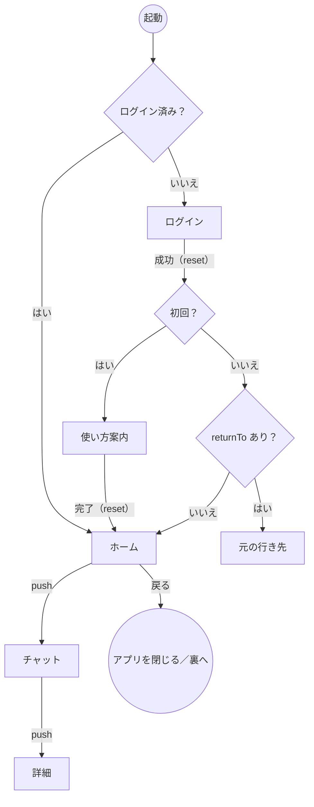
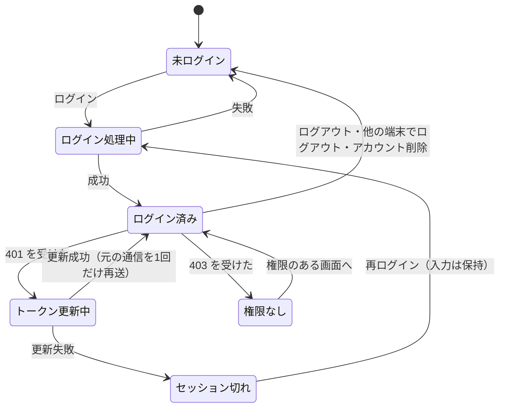

# 05 戻るボタンとログイン周りの決め方

戻るボタンとログインは、ハッピーパスだけを考えていると**ほぼ確実に穴が残る**場所です。
「画面をどう積むか」と「認証の状態」を先に決めておきます。

## 1. 起動から画面までの流れ

```
起動
 ├未ログイン→[ログイン]─成功(reset)→[ホーム]
 └ログイン済→[ホーム]
[ホーム]─push→[チャット]─push→[詳細]
[ホーム]で戻る→アプリを閉じる
```



## 2. 画面の積み方：push／replace／reset

画面は「スタック（積み重ね）」で管理されます。戻るボタンは「一番上を1枚取り除く」操作です。

```
push    [ホーム][チャット]          → [ホーム][チャット][詳細]
replace [ホーム][申込入力]          → [ホーム][申込完了]      （入力画面は消える）
reset   [ログイン]                  → [ホーム]                （全部捨てて置き直す）
```

| 方式 | React Navigation | Expo Router | Jetpack Navigation（Android） | SwiftUI（iOS） | Web |
| --- | --- | --- | --- | --- | --- |
| push | `navigation.push()` | `router.push()` | `navController.navigate()` | `NavigationStack` の `path` に追加 | `history.pushState()`／普通のリンク |
| replace | `navigation.replace()` | `router.replace()` | `navigate()` ＋ `popUpTo(今の画面) { inclusive = true }` | `path` の最後を入れ替える | `history.replaceState()`／`location.replace()` |
| reset | `navigation.reset()`、または認証状態で画面の定義ごと切り替える | `Redirect`・保護されたルート | `navigate()` ＋ `popUpTo(グラフの開始) { inclusive = true }` | `path` を空にする／ルートの画面を切り替える | ― |

React Navigation の公式ドキュメントは、ログインについて「ナビゲートで移動する」のではなく、**ログイン状態によって定義する画面そのものを切り替える**方法を勧めています。こうすると、ログイン後に戻るボタンでログイン画面へ戻ること自体が起こりえません。

## 3. 決めておく項目

| 項目 | 決め方 | なぜ |
| --- | --- | --- |
| ログイン成功時 | **reset** | 戻るボタンでログイン画面に戻れないようにする |
| ログアウト時 | **reset** してログイン画面へ。端末内の個人データ（キャッシュ・下書き）も消す | 戻るボタンでログイン後の画面が見えてしまうのを防ぐ |
| 完了画面 | **replace** | 送信完了・決済完了から戻ると入力画面に戻り、もう一度送信できてしまうのを防ぐ |
| 最初の画面で戻る | Android ではアプリを閉じる（裏へ回す）。または「もう一度押すと終了」にする | ― |
| 入力途中で戻る | 破棄の確認を出す、または下書きを自動保存する | 入力が消えるのが一番嫌われる |
| 戻るの連打 | 画面切り替え中は操作を受け付けない。同じ画面を二重に push しない | 2回押すと2画面戻る／同じ画面が2枚積まれる |
| ボタンの二重タップ | 画面遷移の前に1回目でボタンを無効にする。同じ画面を2枚積まない設定を使う（Jetpack なら `launchSingleTop = true`） | 一覧から詳細へ、同じ詳細画面が2枚積まれる |

## 4. プラットフォームごとの注意点

### Android

- **Android 12 以降**、最初の画面（ルートのアクティビティ）で戻るを押すと、アプリは終了せず**裏へ回る**のが標準の動きになりました。「戻る＝アプリ終了」と思い込んで終了処理を書かない
- **予測型「戻る」（Predictive Back）**：Android 13 以降、戻るジェスチャーの途中で「戻った先」がプレビューされる仕組みが段階的に導入されています。`onBackPressed()` を上書きする古い書き方ではなく、`OnBackPressedCallback`（AndroidX）などで「戻るを横取りするか」を登録する方式で書く
- 戻るボタン（またはジェスチャー）は**システムのもの**なので、アプリのボタンを無効にしても押せます。「送信中＋戻る」は必ず決める
- 端末の設定で「アクティビティを保持しない」をオンにすると、画面を離れるたびに画面が破棄されます。状態の保存・復元のテストに使えます（[08章](08-training.md)）

### iOS

- 画面左端からのスワイプで戻れます（ナビゲーションバーの戻るボタンを隠しても、スワイプは別に考える必要がある）
- 完了画面など、戻らせたくない画面ではスワイプで戻る操作も止める（SwiftUI の `navigationBarBackButtonHidden(true)` は戻るボタンを隠し、スワイプでの戻りも効かなくなる）
- 下から出てくるシート（モーダル）は、下へスワイプで閉じられます。入力途中のシートは `interactiveDismissDisabled()` で閉じられないようにするか、閉じる前に確認を出す

### Web

- **PRG パターン（Post/Redirect/Get）**：フォームを POST したら、結果ページへリダイレクトしてから GET で表示します。こうすると、完了ページで再読み込みしても「フォームを再送信しますか？」にならず、二重送信を防げます
- 完了ページへは `location.replace()` で移動すると、戻るボタンで入力ページに戻れなくなります
- ブラウザの **bfcache**（戻る・進むのキャッシュ）により、戻ったときにページが「前の状態のまま」復元されることがあります。送信中の表示のまま止まって見える場合は、`pageshow` イベント（`event.persisted` が true）で状態を確認し直す
- 入力途中でタブを閉じる・別ページへ行く場合は、`beforeunload` で確認を出す（ただし表示される文言はブラウザが決める）

## 5. ログイン周りの状態



### 決めておく項目

| 場面 | 決め方 |
| --- | --- |
| 未ログインで、ログイン必須の画面に直接来た（通知タップ・リンク・ブックマーク） | ログイン画面へ → ログイン後に**元の行き先へ戻す（returnTo）** |
| ログイン済みでログイン画面に来た | ホームへ飛ばす |
| 操作途中のセッション切れ | 最悪なのは「ログイン画面に飛ばされて入力が消える」こと。**入力を残す→再ログイン→元の操作を再開**、の流れにする |
| 初回ログインと2回目以降 | 使い方の案内を分ける。「案内を見たか」を端末に持つかサーバーに持つか決める（機種変更・複数端末で再表示してよいか） |
| 別の端末でログアウトされた | 次の通信で 401。ログイン画面へ（理由を表示する） |
| アカウントが削除された | 次の通信で 401／403。端末内のデータを消してログイン画面へ |
| 権限を外された | 次の通信で 403。「権限がありません」を表示し、権限のある画面へ |

### 気をつけたい落とし穴

**① returnTo はそのまま信じない（オープンリダイレクト）**
`/login?returnTo=https://悪いサイト.example` のようなリンクを踏ませて、ログイン後に偽サイトへ飛ばす攻撃があります。
returnTo は「自分のアプリ内のパス（`/` で始まり、`//` で始まらない）」だけを受け付けます。

**② トークン更新の同時実行**
画面が同時に3つの通信をしていて、3つとも 401 を受けると、トークン更新が3回走ります。
更新は1回だけ行い、他の2つはその結果を待つ（シングルフライト）ようにします。
リフレッシュトークンを使うたびに作り直す方式（ローテーション）で「古いトークンの再利用」を検出する仕組みがある場合、同時更新を「盗まれたトークンの再利用」と誤判定して、全セッションが無効になることがあります。

**③ 再ログインは「今の画面の上」で行う**
セッション切れのとき、画面を全部捨ててログイン画面に reset すると、入力が消えます。
モーダル（今の画面の上に重ねる）で再ログインし、閉じたら元の画面に戻って操作を再開します。
入力内容は、念のため端末の保存領域にも下書きとして保存しておきます。

**④ 他人のデータのIDに直接来た**
通知やリンクで `/posts/123` に来たが、123 は他人の非公開データだった、という場合。
サーバーは 403 ではなく **404 を返す**と、「そのIDのデータが存在する」こと自体を知られずに済みます。
画面側も「見つかりません」を表示します（OWASP API Security Top 10 の1位、BOLA への対策の一部）。

**⑤ 通知から起動したときの画面スタック**
通知から詳細画面を直接開くと、スタックに詳細画面1枚しかなく、戻るとアプリが閉じてしまいます。
「ホーム → 詳細」のようにスタックを組み立ててから開くか、詳細画面に「ホームへ」ボタンを置くかを決めます。
