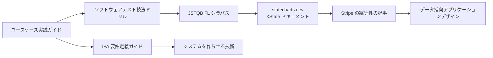

# 09 参考書・資料

元の文章は「9. 参考書『ユースケース実践…』」で途切れていたので、分野ごとにまとめ直しました。
書名・出版社は確認できた範囲で書いています。版が新しくなっていることがあるので、買う前に最新版を確認してください。

## まず読む3冊（迷ったらここから）

| 順 | 本 | なぜこれか |
| --- | --- | --- |
| 1 | アリスター・コーバーン『ユースケース実践ガイド ― 効果的なユースケースの書き方』（翔泳社） | 元の文章が挙げていた本。基本／代替／例外フロー、ゴールのレベル（粒度）の考え方の原典。L2 の書き方がこれ1冊で身につく |
| 2 | 秋山浩一『ソフトウェアテスト技法ドリル ― テスト設計の考え方と実際』（日科技連出版社） | 状態遷移テスト・デシジョンテーブル・境界値分析を、手を動かす問題で身につける。「異常系を漏れなく出す型」 |
| 3 | JSTQB Foundation Level シラバス（JSTQB のサイトで無料） | テスト技法の全体像。資格を取らなくても、地図として読む価値がある |

## 分野別

### 業務分析・要件定義（L0〜L1）

| 本・資料 | 何が学べるか |
| --- | --- |
| IPA『ユーザのための要件定義ガイド』（IPA のサイトで無料） | 発注者側の視点での要件定義の進め方と勘どころ。中小企業でのヒアリングに直結する |
| IPA『機能要件の合意形成ガイド』（IPA のサイトで無料） | 画面・帳票・データ・処理の要件を、発注者と開発者が合意するための書き方 |
| IPA『非機能要求グレード』（IPA のサイトで無料） | 性能・可用性・セキュリティなど、見落としやすい「機能以外の要件」の一覧表 |
| 白川克・浜本佳史『システムを作らせる技術』（日本経済新聞出版） | 発注者（ユーザー企業）がシステム開発をどう進めるか。業務側とIT側の橋渡しの考え方 |
| 赤俊哉『はじめての上流工程をやり抜くための要件定義のセオリー』（リックテレコム） | 要件定義の進め方を、成果物と手順で解説 |
| 神崎善司『モデルベース要件定義テクニック』（秀和システム） | RDRA（要件をモデルで整理する手法）の解説。「システム価値→外部環境→境界→システム」の順に整理する |
| 清水吉男『要求を仕様化する技術・表現する技術』（技術評論社） | USDM（要求と仕様を階層で書く手法）。「要求」と「仕様」を分けて書く感覚が身につく |
| ジェフ・パットン『ユーザーストーリーマッピング』（オライリー・ジャパン） | 利用者の行動を横に並べ、優先度で縦に切る。L1〜L2 と優先度づけの両方に効く |

### ユースケース・ドメインの理解（L2）

| 本・資料 | 何が学べるか |
| --- | --- |
| アリスター・コーバーン『ユースケース実践ガイド』（翔泳社） | 上記。ゴールのレベル（雲・凧・海面・魚・貝）は、この教材のズームの階段と同じ発想 |
| 成瀬允宣『ドメイン駆動設計入門』（翔泳社） | 業務の言葉をそのままコードの構造にする考え方の入門 |
| ヴラッド・ホノノフ『ドメイン駆動設計をはじめよう』（オライリー・ジャパン） | 業務の分け方（境界づけ）と、イベントストーミングによる業務の掘り起こし |
| アルベルト・ブランドリーニ "Introducing EventStorming"（Leanpub、英語） | イベントストーミングの考案者による本 |

### 画面・情報設計（L3）

| 本・資料 | 何が学べるか |
| --- | --- |
| ソシオメディア（上野学・藤井幸多）『オブジェクト指向UIデザイン ― 使いやすいソフトウェアの原理』（技術評論社） | 画面を「操作の手順」ではなく「対象（もの）」から設計する方法。画面一覧と遷移の整理に効く |
| ルイス・ローゼンフェルドほか『情報アーキテクチャ 第4版』（オライリー・ジャパン） | 情報の分類・ナビゲーション・ラベルの設計 |
| D.A.ノーマン『誰のためのデザイン？ 増補・改訂版』（新曜社） | エラーはなぜ起きるか、エラーを防ぐ・回復させる設計の原理 |
| React Navigation・Jetpack Navigation・SwiftUI の公式ドキュメント | push／replace／reset の具体的な書き方。特に React Navigation の「Authentication flows」 |

### 状態遷移設計（L4）

| 本・資料 | 何が学べるか |
| --- | --- |
| 児玉公信『UMLモデリングの本質』（日経BP） | UML の状態マシン図を含むモデリングの考え方 |
| デイビッド・ハレル "Statecharts: A Visual Formalism for Complex Systems"（1987年の論文、英語） | ステートチャート（入れ子・並行の状態）の原典 |
| statecharts.dev（Web、英語・無料） | ステートチャートの入門。「なぜ状態機械を使うのか」が分かる |
| XState・Stately の公式ドキュメント（Web、英語・無料） | 状態機械をコードにし、図で確認する方法 |
| リチャード・フェルドマン "Making Impossible States Impossible"（講演動画、英語） | 「ありえない状態を型で作れなくする」の元になった有名な講演 |
| ケント・C・ドッズ "Stop using isLoading booleans"（ブログ、英語） | true/false の組み合わせで状態を持つ問題点 |

### 通信・冪等性・リトライ（L5）

| 本・資料 | 何が学べるか |
| --- | --- |
| マーティン・クレップマン『データ指向アプリケーションデザイン』（オライリー・ジャパン） | 分散システムで「1回だけ処理する」ことがなぜ難しいか。冪等性・トランザクション・再試行の理論 |
| マイケル・T・ナイガード『Release It!』（オーム社） | タイムアウト・サーキットブレーカー・隔壁など、本番で壊れないための設計パターン |
| 水野貴明『Web API: The Good Parts』（オライリー・ジャパン） | API の設計とエラーの返し方 |
| Stripe "Designing robust and predictable APIs with idempotency"（ブログ、英語・無料） | 冪等キーの実践的な解説。この教材の冪等キーの設計はこの考え方に沿っている |
| Stripe API リファレンス "Idempotent requests"（英語・無料） | 冪等キーの具体的な仕様（保持期間、同時実行時の扱い） |
| IETF "The Idempotency-Key HTTP Header Field"（インターネットドラフト、英語・無料） | `Idempotency-Key` ヘッダの標準化案 |
| マーク・ブルッカー "Exponential Backoff And Jitter"（AWS Architecture Blog、英語・無料） | 再試行の間隔にランダムなずれを入れる理由と効果 |

### テスト技法（抜け漏れの検出）

| 本・資料 | 何が学べるか |
| --- | --- |
| JSTQB Foundation Level シラバス（無料） | テスト技法の全体像 |
| 秋山浩一『ソフトウェアテスト技法ドリル』（日科技連出版社） | 上記。問題を解きながら技法を身につける |
| 梶本和博ほか『ソフトウェアテスト技法練習帳 ― 知識を経験に変える40問』（技術評論社） | 技法ごとの練習問題。ドリルの次に |
| リー・コープランド『はじめて学ぶソフトウェアのテスト技法』（日経BP） | テスト技法の定番の教科書 |
| 高橋寿一『知識ゼロから学ぶソフトウェアテスト』（翔泳社） | テストの考え方の入門。最初の1冊にも |
| セム・ケイナーほか『ソフトウェアテスト293の鉄則』（日経BP） | テストの実践知を短い教訓で集めた本 |
| Elisabeth Hendrickson ほか "Test Heuristics Cheat Sheet"（英語・無料） | 異常系の発想の手がかり集（0・1・たくさん、中断、境界…） |
| Microsoft PICT（GitHub、無料） | ペアワイズ法で組み合わせのテストケースを作るツール |

### 図の描き方・ツール

| 資料 | 何が学べるか |
| --- | --- |
| Mermaid 公式ドキュメント（mermaid.js.org、無料） | flowchart・stateDiagram・sequenceDiagram の書き方 |
| C4 model（c4model.com、英語・無料） | 構成図のズームレベル（Context→Container→Component→Code）。粒度の考え方の参考 |
| OMG BPMN 2.0 仕様（無料） | 業務フローの記法の標準。全部読む必要はなく、記号の一覧として使う |

### セキュリティ（「他人のデータが見えない」を守る）

| 資料 | 何が学べるか |
| --- | --- |
| OWASP API Security Top 10（2023年版、無料） | API の代表的な弱点。1位の BOLA（オブジェクト単位の認可の不備）は必読 |
| IPA『安全なウェブサイトの作り方』（無料） | Web アプリの代表的な脆弱性と対策（日本語） |

### 意思決定

| 資料 | 何が学べるか |
| --- | --- |
| ジェフ・ベゾス「2015年 株主への手紙」（英語・無料） | 一方向ドア（Type 1）と二方向ドア（Type 2）の決定の考え方の出典 |
| ADR（Architecture Decision Record）の各種テンプレート（GitHub の adr 関連リポジトリ、無料） | 一方向ドアの決定を短く記録する書式 |

## 読む順番のおすすめ

- 上の流れ（ユースケース → テスト技法 → 状態機械 → 冪等性）は、**作る側の解像度**を上げる道
- 下の流れ（IPA → システムを作らせる技術）は、**業務を聞く側の解像度**を上げる道。中小企業でのヒアリングを目指すならこちらも並行して読む
