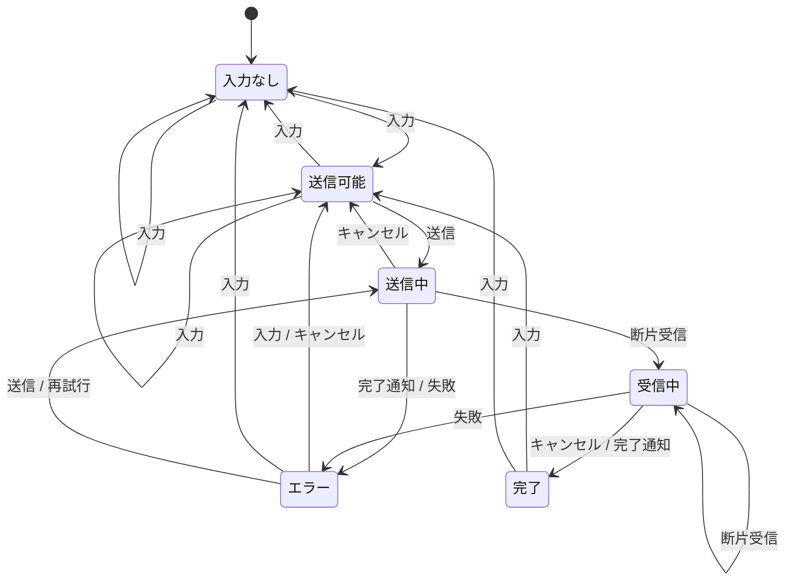

<!-- このファイルは自動生成です。直接編集せず、sendState.ts を直してから npm run spec を実行してください -->

# 仕様書：「AIに質問を送る」の状態遷移（自動生成）

- 状態 6 個 × イベント 7 個 ＝ **42 マス**（空欄 0）
- うち遷移するマス 16、無視するマス 26
- 「無視」も仕様です。「決めていない」との違いは、ここに書いてあるかどうかです

## 状態遷移図

「無視」のマスは図に描いていません（下の表で確認できます）。

## 状態×イベント表

| 状態＼イベント | INPUT 入力 | SUBMIT 送信タップ（連打含む） | CANCEL キャンセル／戻る | CHUNK 応答の断片が届く | COMPLETE 応答完了 | FAIL 失敗（切断・タイムアウト・認証切れ等） | RETRY 再試行 |
| --- | --- | --- | --- | --- | --- | --- | --- |
| **入力なし** `empty` | 送信可能 / 入力なし | （無視） | （無視） | （無視） | （無視） | （無視） | （無視） |
| **送信可能** `ready` | 送信可能 / 入力なし | 送信中 | （無視） | （無視） | （無視） | （無視） | （無視） |
| **送信中** `sending` | （無視） | （無視） | 送信可能 | 受信中 | エラー | エラー | （無視） |
| **受信中** `streaming` | （無視） | （無視） | 完了 | 受信中 | 完了 | エラー | （無視） |
| **エラー** `error` | 送信可能 / 入力なし | 送信中 | 送信可能 | （無視） | （無視） | （無視） | 送信中 |
| **完了** `done` | 送信可能 / 入力なし | （無視） | （無視） | （無視） | （無視） | （無視） | （無視） |

## 各マスの仕様

### 入力なし（`empty`）

| イベント | 次の状態 | どうする |
| --- | --- | --- |
| 入力 (`INPUT`) | 送信可能 / 入力なし | 文字が入れば送信可能へ。空白だけなら入力なしのまま |
| 送信タップ（連打含む） (`SUBMIT`) | （無視） | 送信ボタンは押せない（無効化）。届いても無視する |
| キャンセル／戻る (`CANCEL`) | （無視） | 何もしない |
| 応答の断片が届く (`CHUNK`) | （無視） | 前の依頼の残骸なので破棄する |
| 応答完了 (`COMPLETE`) | （無視） | 前の依頼の残骸なので破棄する |
| 失敗（切断・タイムアウト・認証切れ等） (`FAIL`) | （無視） | 前の依頼の残骸なので破棄する |
| 再試行 (`RETRY`) | （無視） | 再試行する対象がない |

### 送信可能（`ready`）

| イベント | 次の状態 | どうする |
| --- | --- | --- |
| 入力 (`INPUT`) | 送信可能 / 入力なし | 下書きを更新する。全部消したら入力なしへ |
| 送信タップ（連打含む） (`SUBMIT`) | 送信中 | 送信中へ。requestId はこの瞬間に1つだけ発行し、以後の再試行でも使い回す |
| キャンセル／戻る (`CANCEL`) | （無視） | 何もしない（下書きは残す） |
| 応答の断片が届く (`CHUNK`) | （無視） | 前の依頼の残骸なので破棄する |
| 応答完了 (`COMPLETE`) | （無視） | 前の依頼の残骸なので破棄する |
| 失敗（切断・タイムアウト・認証切れ等） (`FAIL`) | （無視） | 前の依頼の残骸なので破棄する |
| 再試行 (`RETRY`) | （無視） | 再試行する対象がない |

### 送信中（`sending`）

| イベント | 次の状態 | どうする |
| --- | --- | --- |
| 入力 (`INPUT`) | （無視） | 入力欄はロック中（送った内容と画面の表示を一致させる） |
| 送信タップ（連打含む） (`SUBMIT`) | （無視） | 連打は無視する（ボタンの無効化に加えて、ここでも防ぐ二重防御） |
| キャンセル／戻る (`CANCEL`) | 送信可能 | 送信可能へ戻し、下書きを復元する。※サーバー側ではすでに処理が進んでいる可能性がある |
| 応答の断片が届く (`CHUNK`) | 受信中 | 今の依頼への応答なら受信中へ。違う requestId は無視する |
| 応答完了 (`COMPLETE`) | エラー | 本文0文字で完了した＝AIのおかしな出力。エラー(empty)にして再試行できるようにする |
| 失敗（切断・タイムアウト・認証切れ等） (`FAIL`) | エラー | エラーへ。下書きは保持し、同じ requestId で再試行できるようにする |
| 再試行 (`RETRY`) | （無視） | 送信中なので不要 |

### 受信中（`streaming`）

| イベント | 次の状態 | どうする |
| --- | --- | --- |
| 入力 (`INPUT`) | （無視） | 入力欄はロック中 |
| 送信タップ（連打含む） (`SUBMIT`) | （無視） | 連打は無視する |
| キャンセル／戻る (`CANCEL`) | 完了 | 生成を止める。ここまでの回答を残して完了扱いにする（stopped=true） |
| 応答の断片が届く (`CHUNK`) | 受信中 | 回答に追記する。違う requestId は無視する |
| 応答完了 (`COMPLETE`) | 完了 | 完了へ。履歴は1件だけ保存する（2件ではない） |
| 失敗（切断・タイムアウト・認証切れ等） (`FAIL`) | エラー | 途中までの回答を partial に残してエラーへ。再試行は同じ requestId で行う |
| 再試行 (`RETRY`) | （無視） | 受信中なので不要 |

### エラー（`error`）

| イベント | 次の状態 | どうする |
| --- | --- | --- |
| 入力 (`INPUT`) | 送信可能 / 入力なし | 入力を書き換えたら別の依頼になる。古い requestId は捨て、次の送信で新しく発行する |
| 送信タップ（連打含む） (`SUBMIT`) | 送信中 | エラー中の送信ボタンは再試行と同じ扱い。新しいIDは使わず、同じ requestId を使い回す |
| キャンセル／戻る (`CANCEL`) | 送信可能 | エラーを閉じて送信可能へ戻る（下書きは残す） |
| 応答の断片が届く (`CHUNK`) | （無視） | エラー確定後に遅れて届いた応答は破棄する（再試行すればサーバーが保存済みの結果を返すので損はない） |
| 応答完了 (`COMPLETE`) | （無視） | エラー確定後に遅れて届いた完了通知は破棄する（同上） |
| 失敗（切断・タイムアウト・認証切れ等） (`FAIL`) | （無視） | すでにエラーなので、エラーを二重に表示しない |
| 再試行 (`RETRY`) | 送信中 | 同じ requestId で送信中へ。サーバーは処理済みなら保存済みの結果を返す（AIを2回動かさない） |

### 完了（`done`）

| イベント | 次の状態 | どうする |
| --- | --- | --- |
| 入力 (`INPUT`) | 送信可能 / 入力なし | 次の質問の入力を始める |
| 送信タップ（連打含む） (`SUBMIT`) | （無視） | 入力欄は空なので送信ボタンは無効 |
| キャンセル／戻る (`CANCEL`) | （無視） | 何もしない |
| 応答の断片が届く (`CHUNK`) | （無視） | 完了後に届いた残骸は破棄する |
| 応答完了 (`COMPLETE`) | （無視） | 完了通知が2回来ても無視する（履歴を2件にしない） |
| 失敗（切断・タイムアウト・認証切れ等） (`FAIL`) | （無視） | 完了後の失敗通知は無視する |
| 再試行 (`RETRY`) | （無視） | 「回答を作り直す」は再試行ではなく別機能として設計する |
