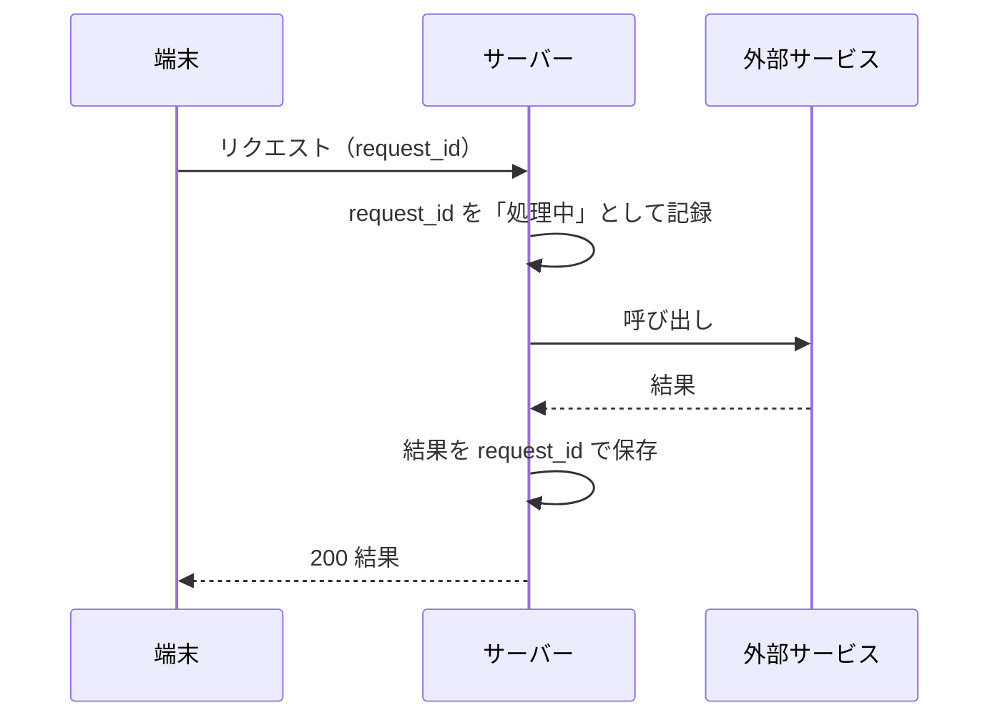
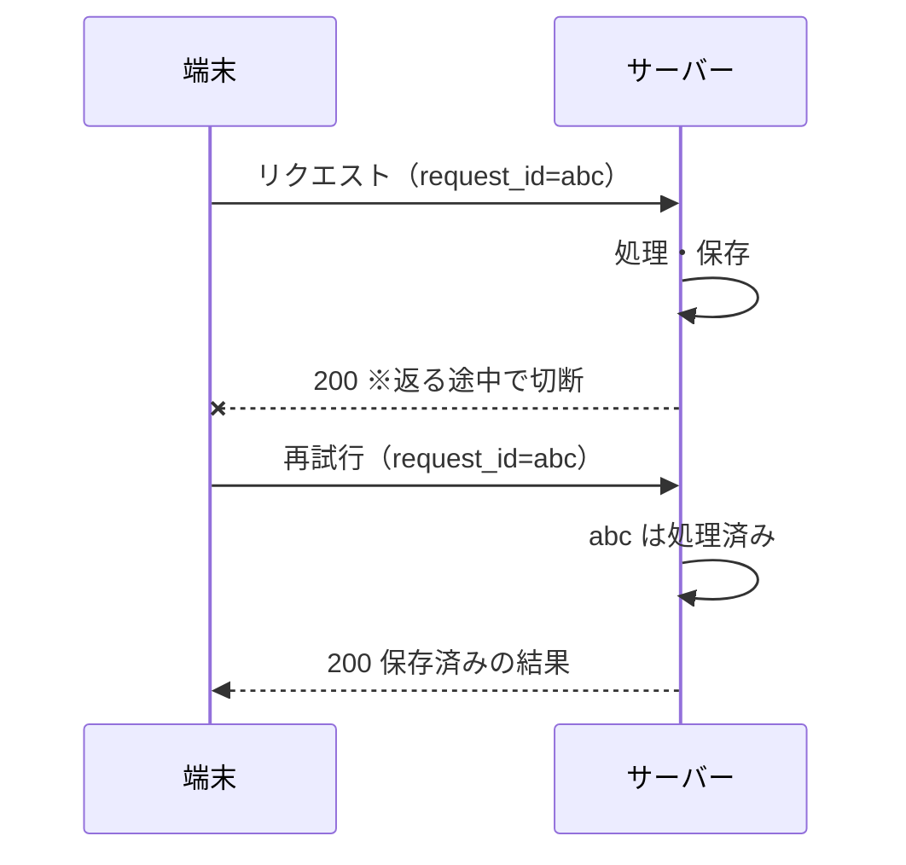

# シーケンス図（L5）

> 使い方：一方向ドア（課金・決済・投稿・データ削除・外部サービス呼び出し）に関わる操作で描きます。
> **ハッピーパスの図を1枚描いたら、矢印1本ごとに「ここで切れたら？」を考え、切れる位置ごとに1枚ずつ描きます。**

## 対象

| 項目 | 記入 |
| --- | --- |
| 操作 | |
| 冪等キー | （何をキーにするか。例：user_id + request_id） |
| 関連する状態×イベント表のマス | |

## ハッピーパス

## 失敗する位置の一覧

| # | 切れる位置 | サーバーの状態 | 端末の認識 | 再送してよいか | 対策 |
| --- | --- | --- | --- | --- | --- |
| 1 | 端末→サーバーの途中 | 何も起きていない | 失敗 | よい | 同じ request_id で再送 |
| 2 | サーバー→外部サービスの途中 | 処理中 | 待ち／タイムアウト | 冪等キーがあればよい | 処理中なら 409、リース期限で回収 |
| 3 | 外部サービス→サーバーの途中 | 外部では成功している可能性 | 待ち／タイムアウト | 外部サービスに冪等キーを渡していればよい | 外部サービス側の冪等キーも使う |
| 4 | サーバー→端末の途中 | 成功している | 失敗 | **冪等キーがないとダメ** | 保存済みの結果を返す |

## 失敗のシーケンス（位置4の例）

## チェックリスト

- [ ] 矢印1本ごとに「ここで切れたら？」を考えた
- [ ] 切れる位置ごとに、再送してよいかを決めた
- [ ] 再試行の回数・間隔（指数バックオフ＋ジッター）・合計時間の上限を決めた
- [ ] タイムアウトの値を決めた（ストリーミングなら「最初の断片まで」と「断片の間隔」）
- [ ] 外部サービスにも冪等キーを渡せるか確認した
